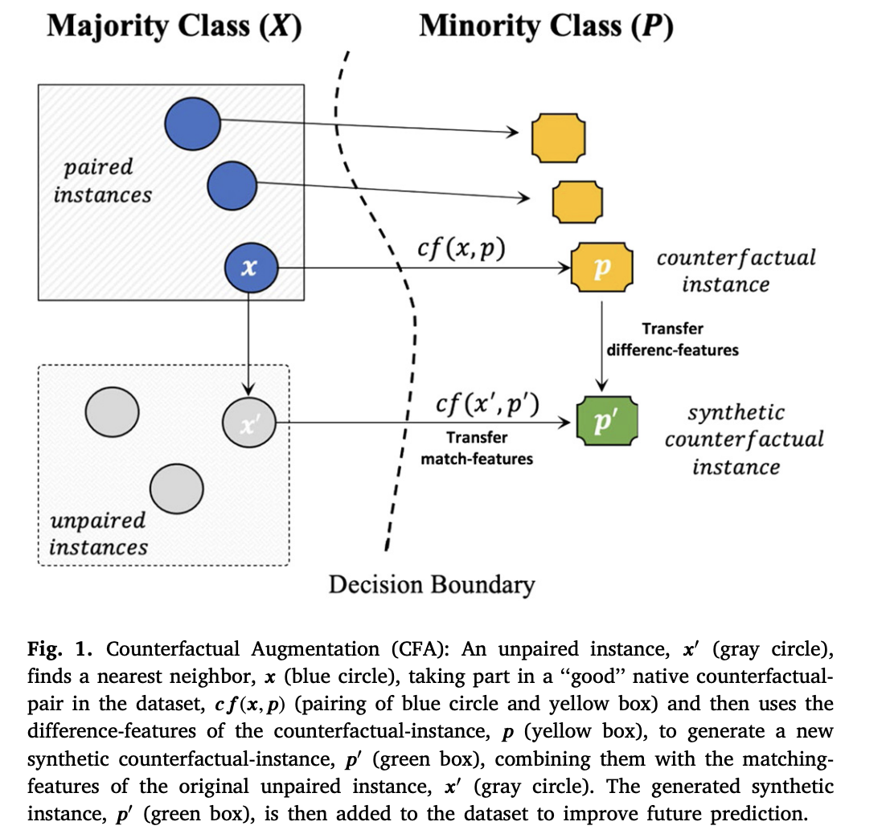

# CFA — Counterfactual Data Augmentation for Class Imbalance

Python implementation of the algorithm from:

> Temraz, M., & Keane, M. T. (2022). Solving the class imbalance problem using a
> counterfactual method for data augmentation. *Machine Learning with Applications*,
> **9**, 100375. [doi:10.1016/j.mlwa.2022.100375](https://doi.org/10.1016/j.mlwa.2022.100375)
> · [arXiv:2111.03516](https://arxiv.org/abs/2111.03516)

CFA generates synthetic minority-class instances by **transferring feature-values**
from existing counterfactual pairs onto unpaired majority instances — using actual
values from the dataset, not interpolations (contrast with SMOTE and its variants).



## How it works

Let `X` be the majority class and `P` be the minority class.

1. **Find native counterfactual pairs `cf(x, p)`.** For every minority `p`, look for the
   nearest majority `x` whose features differ on at most `max_diff_features` (under a
   per-feature tolerance). These are the "good" native counterfactuals.
2. **For each unpaired majority `x'`,** find its nearest paired majority `x` via
   Euclidean k-NN.
3. **Generate a synthetic minority `p'`** by *transferring* feature-values:
   - For each **difference-feature** between `x` and its counterfactual `p`, copy
     the value from `p` into `p'`.
   - For each **match-feature**, copy the value from `x'` into `p'`.

The per-feature tolerance is `tolerance × std(feature)`; the paper uses
`tolerance = 0.1` (±10 % of std) and `max_diff_features = 2`.

## Install

```bash
pip install -e .
```

Requires Python ≥ 3.10, NumPy ≥ 1.20, scikit-learn ≥ 1.0.

## Usage

```python
from cfa import CFA

cfa = CFA(max_diff_features=2, tolerance=0.1)   # paper defaults

# imblearn-compatible
X_resampled, y_resampled = cfa.fit_resample(X, y)

# Full metadata — which rows are synthetic, minority label, counts, …
result = cfa.run_cfa(X, y)
print(result.n_synthetic, "synthetic rows appended")
print("synthetic mask:", result.synthetic_mask)
```

CFA exposes `fit_resample(X, y)` so it drops into `imbalanced-learn` pipelines
without an imblearn dependency.

## What's new in 0.2

Four correctness fixes relative to 0.1 — all documented in the docstrings with
regression tests:

- **Tolerance formula** was `tol × std + mean` (location-dependent, not what the
  paper defines) and then the per-feature array was never used, the code compared
  against the scalar `self.tol` instead. Fixed: `tol × std` used everywhere.
- **Synthesis rule** was `p' = x' + (p − x)` (vector-add the difference). The
  paper's rule copies `p`'s difference-feature values and `x'`'s match-feature
  values into `p'`. Fixed to match the paper.
- **`fd` semantics were inverted.** The paper's "good counterfactual" allows at most
  *N* difference-features (default 2); the old code's `fd` was the minimum number
  of match-features. Parameter renamed to `max_diff_features` with paper defaults.
- **Synthetic labels were hardcoded to `1`** when `get_synt_labels=False` — broke
  datasets where the minority label is `0` or a string. Fixed: uses the detected
  minority label.

Plus non-correctness improvements:

- Proper Python package (`pip install -e .`), with `pyproject.toml`.
- imblearn-compatible `fit_resample(X, y)` in addition to `run_cfa(X, y)`.
- `CFAResult` dataclass with `X_resampled`, `y_resampled`, `synthetic_mask`,
  `minority_label`, `n_synthetic`.
- KNN is fit once on the majority set (not re-fit per minority instance) and queried
  per minority, so the full `(N_min × N_maj)` neighbour matrix is never materialised.
  Time is still roughly `O(N_min · N_maj · D)`; memory drops from `O(N_min · N_maj)`
  to `O(N_maj)` per iteration. The pre-refactor version re-fit KNN on every minority
  iteration — large constant-factor overhead on realistic sizes.
- Tests: `pytest` suite covering helpers, algorithm correctness, integration.

## API

### `CFA(max_diff_features=2, tolerance=0.1, random_state=None)`

| Parameter | Paper | Meaning |
|---|---|---|
| `max_diff_features` | 2 | max difference-features allowed in a good counterfactual pair |
| `tolerance` | 0.1 | per-feature matching tolerance as a fraction of std |
| `random_state` | — | accepted for sklearn-style compatibility; unused (CFA is deterministic) |

### `CFA.fit_resample(X, y) -> (X_resampled, y_resampled)`

`imbalanced-learn`-compatible interface. Returns the original rows (in order)
followed by the synthetic rows.

### `CFA.run_cfa(X, y) -> CFAResult`

Full result with metadata — use this when you need to know which rows are
synthetic or the detected minority label.

## Examples

See [`examples/cfaExample.ipynb`](./examples/cfaExample.ipynb) for a worked
example. Note: that notebook targets the 0.1 API; the import lines and the
`run_cfa` call signatures need a small update to match 0.2
(`cfa.run_cfa(X, y)` returns a `CFAResult`, or use `cfa.fit_resample(X, y)`
for the tuple API).

## Citation

If you use this library in research, please cite the original paper:

```bibtex
@article{temraz2022cfa,
  title   = {Solving the class imbalance problem using a counterfactual method for data augmentation},
  author  = {Temraz, Mohammed and Keane, Mark T.},
  journal = {Machine Learning with Applications},
  volume  = {9},
  pages   = {100375},
  year    = {2022},
  doi     = {10.1016/j.mlwa.2022.100375},
}
```

## Author & License

- **Algorithm:** Mohammed Temraz and Mark T. Keane
- **Python implementation:** Dorian Joubaud
- **License:** MIT
